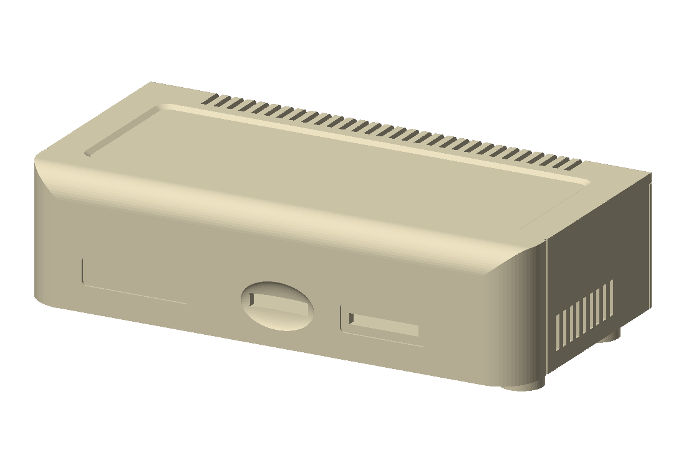
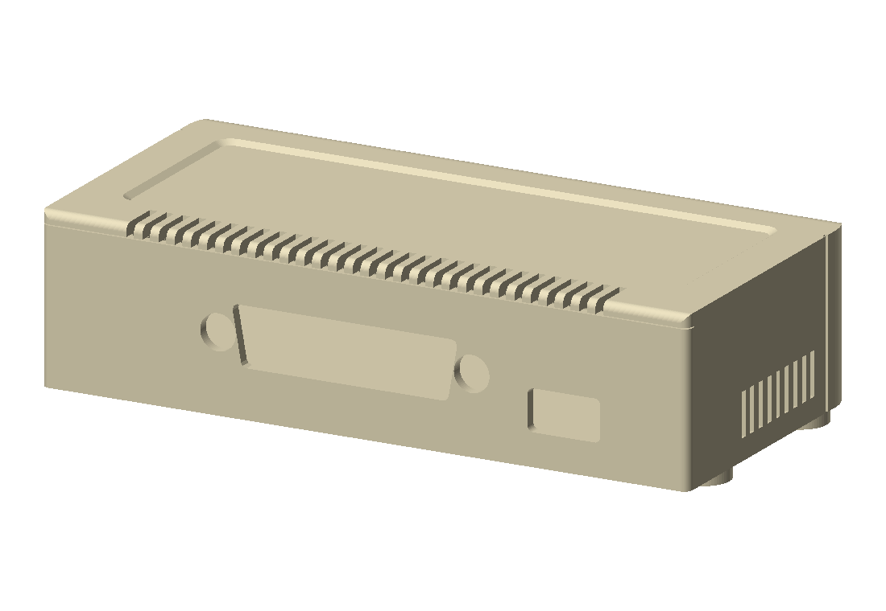

# r2 case

This is a two-piece printed case for the r2 board, shaped like a tiny Apple ProFile.

The real ProFile is 17.28 x 8.81 x 4.39 in. This one keeps those proportions at about 1:3.66, which is what the 100 x 55 mm board needs: 120 x 60.3 x 30.5 mm, plus 2.5 mm feet. It has the rolled front edge, the big rounded front corners, the shallow panel set into the top, the row of vents notched into the back edge of the top, the seam between the front shell and the sides, and two recessed plates on the front where the nameplate and the lamp plate go. I didn't model the Apple logo or the "ProFile" lettering. Those recesses are 26 x 6.6 mm and 20.5 x 6.6 mm, 0.5 mm deep, so a printed sticker drops right in.

## The parts

- `base.stl`: the floor, four board standoffs, the feet, and the whole back panel with the USB-C and DB-25 openings.
- `cover.stl`: the top, front and both sides. It drops over the base from above.

The back panel is part of the base because the DB-25 shell sticks out 5.9 mm past its flange, so a one-piece cover could never be lowered over it. The panel is 2.0 mm thick and sits right on the front face of J2's flange. The opening clears the mating plug's shell and both 4-40 hex standoffs, so a cable seats on the connector as if the panel weren't there. When you pull a cable, the flange pushes against the panel, not against the solder joints.

The front has the microSD slot (with a scoop around it so a fingernail can push the card in and out of the push-push socket) and a window in front of the eight LEDs. 0603 LEDs throw enough light sideways that you can see them through it, though not brightly. If you want them brighter, print the cover in a translucent material, or put a strip of clear tape over the window from the inside.

The headers (J4, J5, J6, J7) and SW1 are inside. You get to them by taking the cover off.

## Ordering it

Upload the two STL files to any print service (JLC3DP, PCBWay, Craftcloud, Shapeways, ...). The units are millimeters. Both parts are small (21 and 31 cm^3), so they're cheap.

I'd pick one of these:

- **MJF or SLS nylon (PA12):** strong, takes thread-forming screws well, and doesn't care which way it's printed. It is gray or dyed black, so you'd have to paint it to get ProFile beige.
- **SLA resin:** smoothest surface, and some resins come in white or beige. Resin is more brittle, so don't overtighten the screws.
- **FDM (PLA or PETG) in a beige filament:** cheapest, and closest to the color without painting. Let the service pick the orientation and add supports. The recessed top panel makes a large bridge if the cover is printed upside down.

## Hardware

- 4x M3 x 6 thread-forming (or self-tapping) pan head screws: board to standoffs
- 4x M3 x 10 thread-forming pan head screws: up through the feet into the cover

Every screw hole is 2.6 mm for M3 thread-forming screws. If you'd rather use brass heat-set inserts, drill the holes out to about 4.0 mm.

## Putting it together

1. Tip the board's front edge up, push the DB-25 shell and its hex standoffs through the back panel, then lay the board down on the standoffs.
2. Screw the board down.
3. Lower the cover straight down over it. The back edge of the top rests on the back panel.
4. Turn it over and put the four long screws up through the feet.

## Caveats

- Nothing here has been printed yet.
- The DB-25 height comes from the NorComp drawing (the flange's bottom edge is level with the board top; the drawing's 3.18 mm is the length of the tails below it) and the standoffs, which put the board's bottom 4.1 mm above the floor. If J2 isn't seated flat on the board, the opening will be a little off. The opening clears J2's own D by about 1.4 mm, but the mating plug's shell (about 41 x 10) by only about 0.4 to 0.5 mm a side.
- The microSD socket is push-push. GCT's drawing puts a locked card's edge about 0.4 mm behind the outside of the front wall (1.5 mm behind at the push point), and an unlocked card sticks out about 2.7 mm. A fingernail reaches it through the scoop. Something like a toothpick works too.
